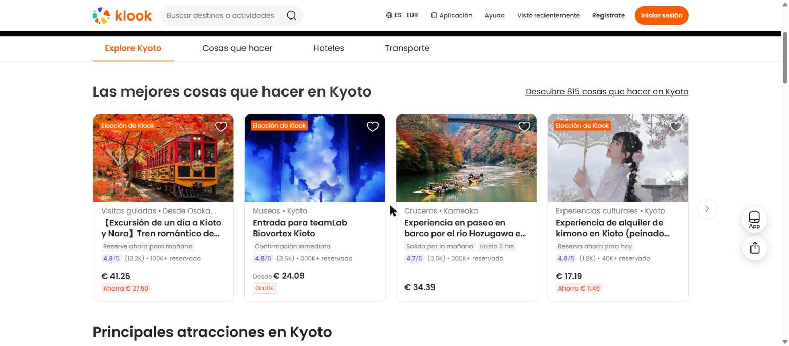
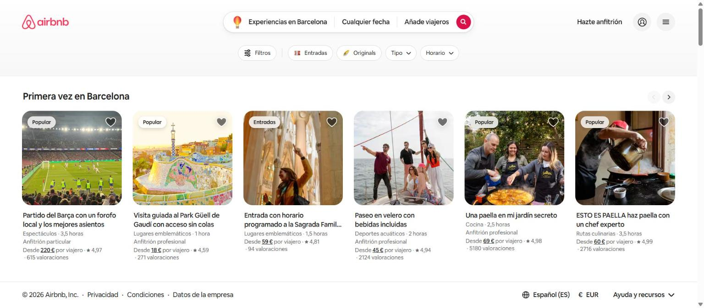
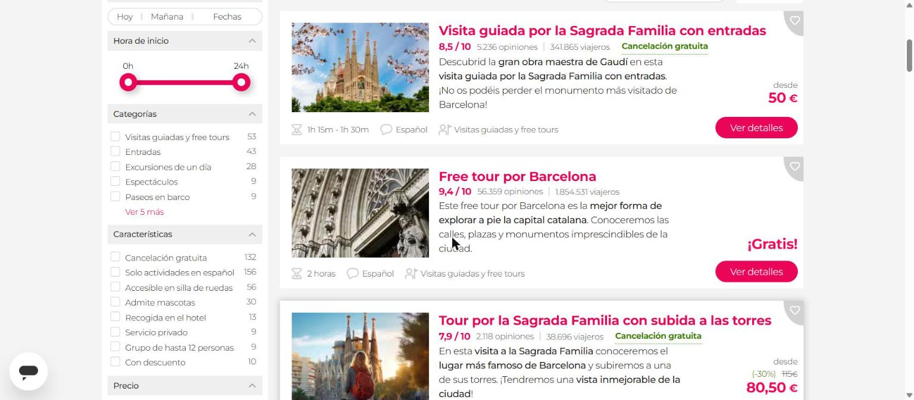

# Wanderlust Explorer

MVP del explorador de experiencias de **Wanderlust Labs**: una app multipágina con **Next.js 16 (App Router), React 19, TypeScript y Tailwind CSS** para descubrir, buscar, filtrar y guardar experiencias de viaje alrededor del mundo.

La búsqueda y los filtros viven en la URL, así que cualquier vista se puede compartir con un enlace:

```
/experiences?search=vela&category=adventure&destination=Croatia
```

## Funcionalidades

| Ruta | Qué muestra |
|---|---|
| `/` | Hero con botón a `/experiences` y accesos rápidos por categoría |
| `/experiences` | Las 100 experiencias en cuadrícula, con buscador, filtro de categoría y filtro de destino |
| `/experiences/[id]` | Detalle completo de una experiencia (leída del dataset local por su ID) |
| `/favorites` | Solo las experiencias marcadas con el corazón |
| `/profile` | Perfil de usuario simulado y resumen de favoritos guardados |

- **Búsqueda por título** con una regex case-insensitive (`new RegExp(term, 'i')`). Los caracteres especiales se escapan, así que escribir `(` o `+` no rompe la app.
- **Filtros combinables**: búsqueda, categoría y destino funcionan por separado y juntos.
- **Estado en la URL**: los filtros se guardan como query params con `useSearchParams`, `usePathname` y `useRouter`. Al abrir un enlace con parámetros, los inputs se prerrellenan y los resultados ya aparecen filtrados.
- **Favoritos**: un corazón en cada tarjeta y en el detalle. La lista de IDs vive en un `useState` de nivel superior y se pasa hacia abajo como props.
- **Navbar** en todas las páginas, con el enlace activo resaltado mediante `usePathname` y un contador de favoritos.
- Mensaje **"No se encontraron resultados"** cuando ningún resultado cumple los filtros.
- Diseño **responsive** (mobile-first, desde 375 px).
- Navegación del lado del cliente con `<Link>`: no hay recargas completas entre páginas.

## Cómo ejecutarlo

```bash
npm install
npm run dev
```

Abre http://localhost:3000. Para verificar el proyecto: `npm run lint` y `npm run build`.

## Arquitectura

```
src/
  app/                      rutas (App Router)
    layout.tsx              Navbar + FavoritesProvider + Footer
    page.tsx                Home
    experiences/page.tsx    Explorador (Suspense alrededor de useSearchParams)
    experiences/[id]/       Detalle (generateStaticParams para las 100 experiencias)
    favorites/page.tsx      Favoritos
    profile/page.tsx        Perfil
  components/
    layout/                 Navbar, NavLinks, Logo, Footer
    experiences/            ExperienceCard, ExperienceGrid, SearchBar, FilterBar, FavoriteButton,
                            ExperienceExplorer, ExperienceDetail, BookingPanel, EmptyState…
    home/                   Hero, CategoryShortcuts
    profile/                ProfileCard, ProfileFavorites, FavoritesSummary
  context/FavoritesContext.tsx   useState de favoritos a nivel de la app
  hooks/
    useFilters.ts           sincroniza búsqueda y filtros con la URL (incluye debounce con useEffect)
    useExperiences.ts       filtra el dataset con regex + categoría + destino (useMemo)
  lib/                      utilidades puras: filtrado, escape de regex, países, formato de precio, categorías
  data/experiences.ts       dataset de 100 experiencias generado con IA
  types/experience.ts       interfaces Experience, ExperienceFilters, CategoryOption
```

### Decisiones técnicas

- **Favoritos sin librerías de estado.** El `useState` vive en `FavoritesProvider`, un componente cliente montado en el layout raíz. Así los favoritos se conservan al navegar entre páginas. En el App Router un layout no puede pasar props directamente a sus páginas, por eso cada página lee el estado con `useFavorites()` (React Context nativo) y desde ahí lo pasa **como props** a `ExperienceGrid`, `ExperienceCard`, `FavoriteButton` y `FavoritesSummary`. No hay persistencia: al recargar se vacían, tal como pide el brief.
- **`useEffect` con dependencias correctas**:
  - en `useFilters`, para escribir el término en la URL 300 ms después de dejar de teclear, con limpieza del temporizador;
  - en `ExperienceDetail`, para actualizar `document.title` y restaurarlo al salir.
- **Custom hooks**: `useFilters` (URL ↔ inputs) y `useExperiences` (lógica de filtrado).
- **Server y Client Components**: las páginas y los componentes sin interactividad se renderizan en el servidor. Solo llevan `'use client'` los que usan estado, hooks de navegación o eventos.

## Design References

UIs reales que inspiraron el diseño (capturas en [`docs/design-references/`](docs/design-references/)):

1. **[Klook](https://www.klook.com/es/)**: tarjetas de experiencia con foto grande, categoría y destino encima del título, valoración, precio y un corazón para guardar en la esquina de la imagen. Inspiró `ExperienceCard`, `FavoriteButton` y `RatingBadge`.
   
2. **[Airbnb Experiencias](https://www.airbnb.es/s/Barcelona/experiences)**: barra de búsqueda tipo píldora, chips de filtro redondeados y una cuadrícula limpia con mucho aire, con precio "desde" y valoración bajo cada foto. Inspiró `SearchBar`, los chips de `FilterBar` y la cuadrícula del explorador.
   
3. **[Civitatis](https://www.civitatis.com/es/barcelona/)**: filtros siempre visibles junto a los resultados (categorías con contador), duración, precio destacado y botón claro de acción. Inspiró el contador de resultados, el botón "Limpiar filtros", los accesos por categoría con su número de experiencias y el panel de precio del detalle (`BookingPanel`).
   

## Dataset

`src/data/experiences.ts` contiene **100 experiencias** generadas con un asistente de código con IA: 20 por categoría (Adventure, Culture, Food, Wellness, Nature), con `id`, `title`, `description`, `category`, `destination` (ciudad + país), `price`, `rating`, `imageUrl` (placeholder de picsum.photos) y `durationHours`. Todas cumplen la interfaz `Experience`.
